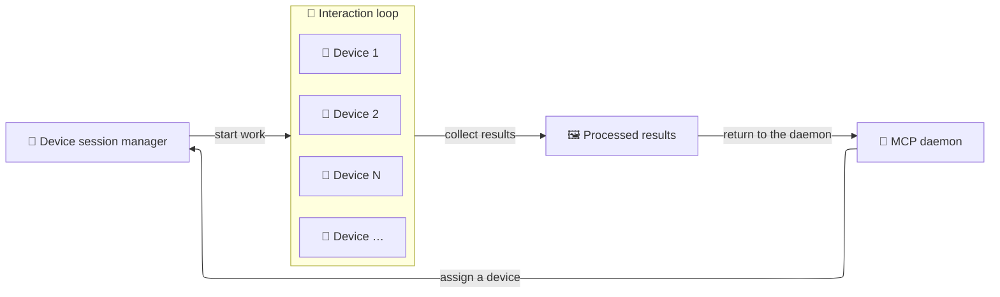

# Daemon

The AutoMobile daemon is a local background service that keeps a pool of
devices ready for work. It assigns a device to each session, proxies the same
MCP tools and resources, and returns the device to the pool when work ends.

It can run as a standalone service, within the MCP server, or temporarily in CI,
so clients need not manage device processes themselves.

## HTTP ingress

We harden daemon HTTP ingress with a per-daemon token. Before binding the loopback
HTTP listener, the daemon generates a fresh bearer token in memory using
`randomBytes(32).toString("base64url")` (256 random bits). The listener requires that
token from its first request. Only after a successful bind does the daemon atomically
publish the token file. A failed bind leaves an existing token file unchanged.
On POSIX the path is `/tmp/auto-mobile-daemon-<uid><isolationSuffix>.token`;
on Windows it is `path.join(process.env.LOCALAPPDATA ?? os.tmpdir(), "auto-mobile", "daemon<isolationSuffix>.token")`.
`AUTOMOBILE_AUX_SOCKET_DIR` determines the same isolation
suffix as those files; `AUTOMOBILE_DAEMON_TOKEN_FILE_PATH` overrides the token path
and relative overrides resolve against the daemon launch directory. Clean shutdown
removes the token file only if it still contains this daemon's published token.

Every HTTP path and method, including `/heartbeat`, `/auto-mobile/streamable`,
OPTIONS and unknown paths, requires `Authorization: Bearer <token>` (the scheme is
case-insensitive). Host and
Origin checks still run first. Missing or invalid credentials return `401`,
`WWW-Authenticate: Bearer`, and `{"error":"Unauthorized"}`. An ingress without a
configured token refuses to start.

The listener binds, and its port is discoverable, before the daemon publishes its
token at the end of device discovery and session rehydration. A request that passes
the Host and Origin checks during that window is held, without evaluating its
credentials, until startup finishes (at most 30 seconds), then authenticated. A client
still holding a previous daemon's token then gets `401` and should re-read the token
file once and retry. If startup outlives that bound the request gets `503` with
`Retry-After: 1` and `{"error":"Daemon is still starting"}`; a failed startup answers
`503` with `{"error":"Daemon startup failed"}`, and a daemon that is shutting down
answers `503`. Treat a `503` carrying `Retry-After` as transient and retry it until
the caller's own deadline. Credentials are removed before MCP dispatch
and are never included in diagnostics, status, PID records or telemetry.

Local clients read the UTF-8 token file and trim whitespace. On POSIX, the file
must be a regular file owned by the current uid with mode `0600`; symlinks are
refused. Writes use an exclusive `0600` temporary file in the same directory and
rename it into place. The parent directory is created with mode `0700` where
supported. Windows uses the same publication rules without POSIX uid/mode checks,
and retries a rename that fails with a transient sharing violation (`EPERM`, `EBUSY`,
`EACCES`) only while the public token file is unchanged since publication began; if
another daemon publishes during the backoff, publication fails without overwriting it
and the aborted store never claims ownership (`remove()` leaves that token alone).
External clients must discover the file using the daemon's
launch environment and read it again after a daemon restart. TypeScript clients
can use `readDaemonHttpToken(env)` or `daemonHttpAuthHeaders(endpoint, env)`, which
returns the Authorization header only for a daemon endpoint (and `{}` for any
other URL): an exact loopback host (`localhost`, `127.0.0.1`, `[::1]`), an explicit
port in the original URL spelling, and path `/auto-mobile/streamable` or `/heartbeat`.
When the daemon PID file (same isolation-aware path as the token) records an HTTP
port, the URL port must equal it; with no discoverable port any explicit port passes.
The PID file is re-read per request. The client-only
`AUTOMOBILE_DAEMON_HTTP_TOKEN` override takes precedence over file discovery.
Keep the token and Authorization header out of logs and error reports.

For backwards compatibility, local HTTP clients obtain the token from the file;
there is no unauthenticated fallback. The CLI, stdio proxy and daemon control commands use the Unix
control socket and do not pass through HTTP ingress. Socket MCP forwarding uses
the in-process transport rather than an HTTP request.

## MCP transport and sessions

The daemon's internal MCP endpoint (`/auto-mobile/streamable`) is stateless: each
request gets its own server and transport, responses carry no `mcp-session-id`, and
there is no transport session to expire, so a daemon restart needs no replay on the
client side. The one session key is the `x-auto-mobile-mcp-session-id` header (or the
in-band `__mcpSessionId` argument). The socket server forwards its socket session id
in that header, and the desktop app sends one id per app session. Tool-to-session
bindings live in a daemon-scoped store rather than on any one server. The design (#4678, #11820) and resolved questions are in
[SDK v2 and stateless daemon layer](sdk-v2-stateless-migration.md).
