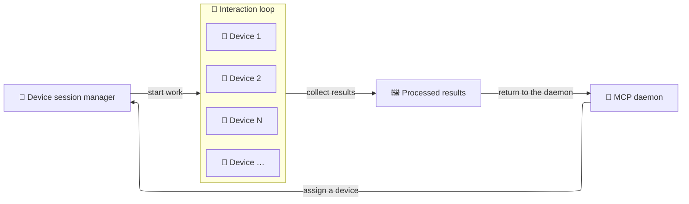

# Daemon

The AutoMobile daemon is a local background service that keeps a pool of
devices ready for work. It assigns a device to each session, proxies the same
MCP tools and resources, and returns the device to the pool when work ends.

This enables parallel test runs and coordinated multi-device actions without
each client needing to manage device processes itself. It can run as a
standalone service, within the MCP server, or temporarily in CI.

## MCP transport and sessions

The daemon's internal MCP endpoint (`/auto-mobile/streamable`) is stateless: each
request gets its own server and transport, responses carry no `mcp-session-id`, and
there is no transport session to expire, so a daemon restart needs no replay on the
client side. The one session key is the `x-auto-mobile-mcp-session-id` header (or the
in-band `__mcpSessionId` argument). The socket server forwards its socket session id
in that header, and the desktop app sends one id per app session. Tool-to-session
bindings live in a daemon-scoped store rather than on any one server. This is in
progress (#4678); the design and open questions are in
[SDK v2 and stateless daemon layer](sdk-v2-stateless-migration.md).
