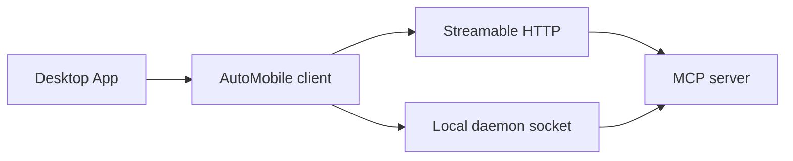

# Desktop App

The AutoMobile Desktop App is a visual workspace for a connected device. Use it when you want to inspect live screens, explore navigation, review failures, or watch performance data without working only through prompts and tool calls.

It connects to AutoMobile automatically and keeps device state, screenshots, and diagnostics in one place. The app is optional: every workflow remains available through the MCP server.

## Connection and device control

The Desktop App automatically uses an available local daemon socket or
Streamable HTTP connection. It cannot connect externally to an MCP process over
stdio.

The app watches first. Selecting or viewing a device holds nothing: the app
registers a read-only observer session and may watch any device, including one
another session holds; control stays with the holder. The first tap, swipe, key
or text input on a free device allocates it for the app, and each later input
restarts the 2-minute idle window. When input stops, the daemon releases the
device and the app drops back to watching; the next input allocates it again. If
another session holds the device, the app's input is refused with
`device_owned_by_other_session` and the app shows that refusal. Closing the last
pane or hiding the window releases a device the app holds. See
[device ownership](../../../using/device-ownership.md) and
[environment variables](../../../using/environment-variables.md#session-heartbeat-timeout).

## Device streams

The app owns one `DaemonStreamHub` per process. Facets lease a device's stream
from the hub, keyed by `deviceSessionUuid` (with `deviceId` as label and
fallback), instead of opening their own socket:

- Telemetry for every observed device shares one socket and one reader thread.
  Each device gets its own `subscribe` naming its `deviceSessionUuid`, so the
  daemon backfills that device's own history under its own `subscriptionId`; an
  all-devices subscription would backfill only the newest rows across every
  device. Pushes are routed by `subscriptionId`, and the hub also checks the
  `deviceSessionUuid` stamped on each event, so a rebooted device that reuses
  its serial never receives the old epoch's events. A device subscribes with its
  first lease and unsubscribes with its last, and the socket closes when no
  device remains. After a reconnect every live device subscribes again. A
  refused subscription, such as a device that is not live yet, retries on its
  own backoff without affecting other devices; a refused desktop session fails
  them all. A facet mounted on a live subscription first receives its device's
  recent events.
- Observation (Layout, Performance, Navigation) uses one stream per device,
  shared by every facet on it, and every device's stream shares one socket and
  one reader thread. Each device sends its own `subscribe` with its own cadence;
  data frames are routed by `subscriptionId`, and replies to a device's
  `request_navigation_graph` or `request_observation` by the request id (both
  requests name the device's `deviceSessionUuid`). A refused or daemon-ended
  subscription takes down only its own device. A refused desktop session takes
  down every device until the last lease is released. The hub owns each device's
  reconnects: when the socket drops, every device reports disconnected and its
  supervision reconnects it, reopening the shared socket once. A facet on a hub
  stream runs no reconnect loop of its own and only refreshes when its device
  comes back. Cadence requests are merged per device by taking the fastest
  interval any facet asked for, sent as `update_cadence` on that device's
  subscription, and recomputed when a facet leaves. One device's slow collector
  never holds back another: the per-device flows keep the latest frame and drop
  the oldest buffered one. Layout, Performance, Navigation, Storage, the compare
  view and the device-control stream all lease this one stream.
- Storage intent is per lease. The hub counts each `(package, file)` across a
  device's leases. The first lease that asks sends `subscribe_storage` on the
  shared stream, and the last one to let go sends `unsubscribe_storage`. Updates,
  acknowledgements and reconciliation requests for a file reach only the leases
  holding it, without loss. A lease that joins a file the device already
  observes is acknowledged at once, so it reconciles its snapshot. A dropped
  connection forgets every confirmation until the re-registration after the
  reconnect acknowledges the holders again. The daemon owns an observer per
  socket, so a device that leaves a socket other devices keep open sends
  `unsubscribe_storage` for its files.
- Leases are ref-counted per device and stream kind; `subscriptions` and
  `observationSubscriptions` expose the live counts, and
  `telemetryConnectionState`/`observationConnectionState` the per-device health.
- Blocking `readLine()` calls for JSON streams run on a dedicated thread per
  connection, never on `Dispatchers.IO`, so many open streams cannot exhaust the
  shared pool.
- Observation-stream reconnects back off exponentially with up to 20% random
  jitter so devices that dropped together do not reconnect in lockstep. Tests
  inject the delay and the random source.

Failures and video streams still connect per pane, as do observation streams in
hosts without a hub (the IDE plugin) and one-shot captures (a saved screenshot,
a picker thumbnail, the foreground-app lookup), which need a fresh initial frame
that a shared subscription does not replay.
