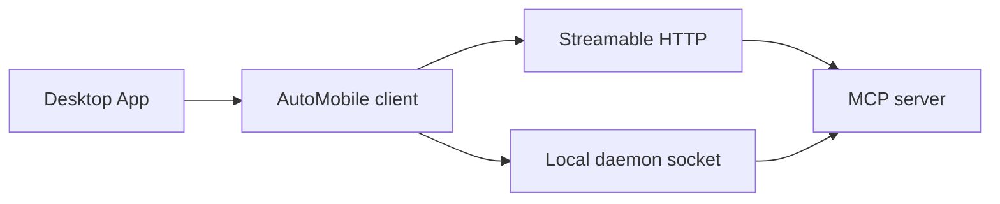

# Desktop App

The AutoMobile Desktop App is a visual workspace for a connected device. Use it when you want to inspect live screens, explore navigation, review failures, or watch performance data without working only through prompts and tool calls.

It connects to AutoMobile automatically and keeps device state, screenshots, and diagnostics in one place. The app is optional: every workflow remains available through the MCP server.

## Connection and device control

The Desktop App automatically uses an available local daemon socket or
Streamable HTTP connection. It cannot connect externally to an MCP process over
stdio.

The app watches first. Selecting or viewing a device holds nothing: the app
registers a read-only observer session and may watch any device, including one
another session holds; control stays with the holder. The first tap, swipe, key
or text input on a free device allocates it for the app, and each later input
restarts the 2-minute idle window. When input stops, the daemon releases the
device and the app drops back to watching; the next input allocates it again. If
another session holds the device, the app's input is refused with
`device_owned_by_other_session` and the app shows that refusal. Closing the last
pane or hiding the window releases a device the app holds. See
[device ownership](../../../using/device-ownership.md) and
[environment variables](../../../using/environment-variables.md#session-heartbeat-timeout).

## Device streams

The app owns one `DaemonStreamHub` per process. Facets lease a device's stream
from the hub, keyed by `deviceSessionUuid` (with `deviceId` as label and
fallback), instead of opening their own socket:

- Telemetry uses one connection per observed device, shared by every facet on
  that device. It subscribes with the device's `deviceSessionUuid`, so the
  daemon backfills that device's own history; an all-devices subscription would
  backfill only the newest rows across every device. The hub also routes on the
  `deviceSessionUuid` stamped on each event, so a rebooted device that reuses
  its serial never receives the old epoch's events. A device's connection opens
  with its first lease and closes with its last; a facet mounted on an open
  connection first receives its device's recent events.
- Observation (Layout, Performance, Navigation) also uses one connection per
  device, shared by every facet on it. The hub owns that connection's
  reconnects, so a facet on a hub stream runs no reconnect loop of its own and
  only refreshes when the shared connection comes back. Cadence requests are
  merged per stream by taking the fastest interval any facet asked for, and
  recomputed when a facet leaves. Storage keeps its own per-pane stream, because
  its updates and subscription acknowledgements are unicast to one pane.
- Leases are ref-counted per device and stream kind; `subscriptions` and
  `observationSubscriptions` expose the live counts, and
  `telemetryConnectionState`/`observationConnectionState` the per-device health.
- Blocking `readLine()` calls for JSON streams run on a dedicated thread per
  connection, never on `Dispatchers.IO`, so many open streams cannot exhaust the
  shared pool.
- Observation-stream reconnects back off exponentially with up to 20% random
  jitter so devices that dropped together do not reconnect in lockstep. Tests
  inject the delay and the random source.

Storage, failures and video streams still connect per pane, as do observation
streams in hosts without a hub (the IDE plugin).

A pane is keyed on its device epoch. When the daemon ends that epoch with a
successor, the pane re-keys onto the successor. When it ends with no successor
(the device disconnected for good), the pane drops the epoch and shows "Device
disconnected" in place of its stream and facets, which releases their leases.
The pane is marked rather than closed so the user sees why the device went away;
it stays until closed, and observing the device again or a fresh epoch for it
(including one reported after a daemon restart) restores the live pane as a new
epoch, so nothing observed from the retired epoch carries over. A daemon
restart that re-mints a live pane's epoch is not a new epoch: that pane keeps
its remembered state. An end for an epoch the pane is not on is ignored.
