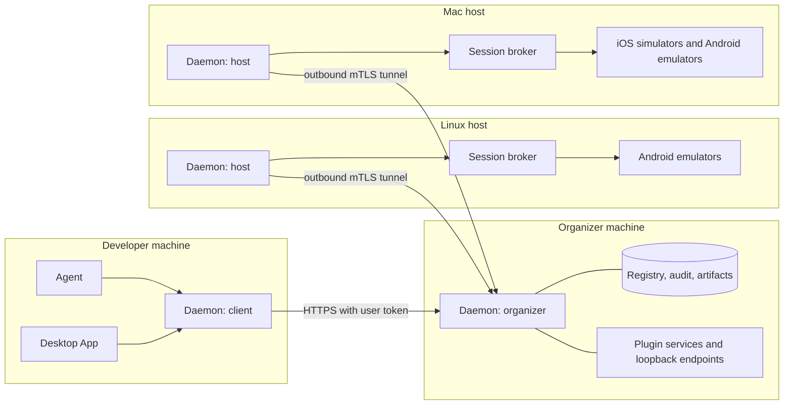

# Device farm design

- Kind: idea
- Date: 2026-11-04
- Source: moved from `how-it-works/device-farm.md`; #16863
- Shaped: [Device farm](../how-it-works/device-farm.md)

Design for running AutoMobile daemons as a shared device farm that several teams' agents use, and for
using the Desktop App to observe, monitor and debug that farm. Status: proposed; none of it is
implemented.

### Summary

An always-on **organizer** daemon places agent requests onto **host** daemons that dial out to it.
Each host's existing [session broker](../how-it-works/session-broker-device-reuse.md) keeps the devices. An agent
asks its local daemon for devices and then drives exactly those devices, without seeing the rest
of the farm. The Desktop App talks only to its local daemon, and the daemon does all the
networking.

The farm does not change a single deployment. A daemon on a laptop, or a single daemon on a remote
server that agents call directly, behaves exactly as it does today unless an operator explicitly
gives it a farm role. See [Standalone guarantee](#standalone-guarantee).

### Goals and non-goals

Goals:

- Teams share a pool of hosts (Linux for Android, Macs for iOS and Android). An agent gets N devices
  on demand and controls them with the same tools as local devices.
- People monitor and debug the farm from the Desktop App: who holds what, what each agent is doing,
  failures, replays, and taking over a device.
- App environments are reproducible: plugins provide mock backends, seed data and device setup, and
  device traffic can loop back to services on the organizer.
- Hosts size their device pools from measured capacity.

Non-goals:

- adb, simctl or any other device protocol crossing the network. Device protocols stay local to the
  host that owns the device.
- The Desktop App dialling remote machines or holding farm credentials.
- Quotas or fair share between teams. Capacity is first come, first served.

### Deployment modes

| Mode                   | Runs on                                 | Adds                                                                                                                         |
| ---------------------- | --------------------------------------- | ---------------------------------------------------------------------------------------------------------------------------- |
| `standalone` (default) | a laptop, CI, or a single remote server | Nothing: today's daemon                                                                                                      |
| `organizer`            | one always-on machine per organization  | Placement, host registry, relay, OIDC sign-in, host CA, TURN, artifact store, loopback endpoints, plugin services, audit log |
| `host`                 | each farm machine with devices          | Outbound tunnel, capacity reports, warm-pool filling, loopback forwarding, plugin hooks, host-local device providers         |
| `client`               | a developer machine that uses the farm  | OIDC sign-in, forwarding of farm requests, the local MCP endpoint for agents and the Desktop App                             |

A daemon is `standalone` unless an operator sets a farm role explicitly, by flag or config file.
There is no discovery, no default organizer address and no automatic enrolment. The design allows
two combinations:
`client` with local devices (local requests never leave the machine), and `organizer` with `host`
on one machine for a small organization.

#### Standalone guarantee

With no farm role configured, the daemon:

1. Opens no new listeners and makes no outbound network connections beyond today's.
2. Exposes the same tools, schemas, resources and results. Farm work never changes
   `schemas/tool-definitions.json` in standalone mode.
3. Loads no farm code at startup: farm modules are imported lazily behind the role check, so startup
   time and memory stay within today's budget.
4. Needs no new configuration, credentials or dependencies, and writes no new files.
5. Keeps the agent-facing MCP endpoint as it is, including the 2025 protocol era and the existing
   `--host` setup with its per-daemon bearer token (see [Daemon](../how-it-works/mcp/daemon.md)).
6. Leaves the Desktop App's behaviour against a local daemon unchanged.

Enforcement:

- A standalone parity harness snapshots the tool list and schemas, the resource list, sockets and
  outbound connections after startup, files created, and startup time and memory. CI fails any
  change that alters them in standalone mode. The harness lands before any farm code.
- One role gate guards all farm code, and a lint test forbids importing farm modules outside it.

The only change that reaches standalone internals is the move of Desktop↔daemon traffic to MCP
2026-07-28 ([Protocol](#protocol)). It is allowed only with no visible change: the old stream API is
removed after the parity harness and the Desktop pane tests pass on the new transport. There is
one Desktop transport for every deployment.

### Architecture

- **Client daemon:** signs the user in, holds a short-lived token and forwards farm requests to the
  organizer. Agents and the Desktop App only talk to localhost.
- **Organizer:** a stateless MCP front door plus a durable registry of hosts, capacity, sessions,
  leases and audit records. It places sessions and relays calls to the pinned hosts.
- **Host daemon:** keeps one outbound tunnel open, reports capacity, fills its warm pool and serves
  relayed calls through its session broker. It is the only component that runs device protocols.

### Session flow

1. The agent asks its local daemon for devices with `location: "farm"`. `startDevice` and session
   requirements take `location: "local" | "farm"`, defaulting to `local`. The rest of the ask
   (platform, count, form factor, OS range, `requires`) is the vocabulary the broker already uses.
2. The client daemon forwards the ask with the user's token.
3. The organizer places the ask on **at most one host per platform**: Android devices share one host
   and iOS devices share one host. The organizer refuses at once an ask no host could ever satisfy.
   One that no host can satisfy yet waits in a first-come queue with a timeout.
4. Each chosen host's session broker allocates the slots, preferring warm devices. The session is
   then **pinned**: every call for those devices is relayed to that host's broker, with no
   re-placement.
5. The agent sees only its own devices and drives them with the normal tools.
6. The session ends on release, lease expiry or idle reclaim. The host broker resets or reuses the
   devices, using [keep-booted reset](../how-it-works/ios-keep-booted-reset.md) where configured.

Failure rules:

- A host that disconnects mid-session pauses the session for a grace window, and calls fail with an
  actionable `host_unavailable` error. If the host returns in time, the session resumes on the same
  devices.
- After the grace window, the session ends. Calls fail with `host_lost`, naming the devices, and the
  agent requests new devices itself. A session never moves to another host automatically, so an
  agent never acts on a device whose state it does not know. The devices are reclaimed when the host
  reconnects.
- If the organizer is unreachable, farm calls fail with an actionable error. Local devices on a
  `client` daemon are unaffected.

### Tunnel

- Opened by the host, outbound only, over TLS 1.3 with the host's mTLS certificate. Hosts need no
  inbound ports.
- One multiplexed connection with three channel types: MCP 2026-07-28 (organizer→host requests and
  host→organizer notifications and subscriptions), port-forward streams for
  [loopback](#network-loopback), and WebRTC signalling for [live video](#live-video).
- The framing (WebSocket over HTTPS with a channel layer, or HTTP/2) is chosen by a measured spike
  of latency, throughput and proxy traversal. The channel interface is the same either way.
- Heartbeats run both ways. Reconnects use `Backoff` with jitter, and a reconnecting host keeps its
  pinned sessions during the grace window.
- Large payloads are not sent inline: they go through the [artifact store](#artifacts) by reference.

### Protocol

Organizer↔host and Desktop↔daemon traffic use only the MCP 2026-07-28 stateless era (see
[SDK v2 adoption survey](../how-it-works/mcp/sdk-v2-adoption-survey.md)). The socket stream API is retired once each
stream has an MCP equivalent:

| Stream today                      | Replacement                                                 |
| --------------------------------- | ----------------------------------------------------------- |
| Observation push                  | `subscriptions/listen` on a per-device observation resource |
| Logs and telemetry                | Subscriptions on per-device log and telemetry resources     |
| Performance, failures, navigation | Subscriptions on per-device resources                       |
| Live video                        | WebRTC; MCP carries only signalling                         |

Every envelope keeps the device session id, so per-device routing carries over to subscriptions.
The agent-facing endpoint (a `client` or `standalone` daemon) keeps serving the 2025 era until the
main agent clients speak 2026-07-28.

### Identity and security

- **People** sign in with OIDC from any provider. The client daemon uses the device-code flow and
  keeps a short-lived, refreshable token scoped to the user's teams. The Desktop App never sees it.
- **Hosts** enrol with a single-use join token created by an org admin. The host redeems it once for
  an mTLS certificate from the organizer's CA, bound to that host and its owning team or org.
  Certificates rotate automatically. Revoking one removes the host.
- **Authorization:** a user controls only the devices in their own sessions. They see full detail
  (screens, activity, replays) for sessions in their own teams, and only counts and free capacity
  per host and platform for the rest of the farm.
- **Audit:** the organizer records every input and every device-changing call with the user,
  session, host and device.
- The organizer is internet-facing. It gets its own threat model, covering token handling, relay
  isolation between sessions and plugin escape, before remote hosts are supported.

### Capacity and placement

- **Host capacity:** each host measures what it can run (CPU, RAM, disk, installed Android images,
  Xcode runtimes, macOS simulator limits, attached USB devices). It advertises a ceiling per
  platform, form factor and OS when it connects. It updates the ceiling when anything changes. An
  operator can lower the ceiling but not raise it past the measurement.
- **Warm pools:** the organizer asks hosts to keep warm devices up to recent demand, within each
  host's ceiling.
- **Sharing:** first come, first served. The only limits are a 2-hour lease, renewable while the
  session is active, and idle reclaim:
  - With no tool call and no session heartbeat for 2 minutes, the devices are reclaimed.
  - A session heartbeat counts as activity, but only for up to 10 minutes after the last tool call.
    An agent thinking between calls keeps its devices, while a stuck agent that only heartbeats
    loses them after 10 minutes instead of holding them until the lease ends.

  The admin can change all three limits. One team can take all free capacity until its leases end.

- **Placement:** ties go to the host with the most warm matching devices, then the least load.
- **Host-local providers:** a host can add devices it rents, such as Android Device Streaming
  ([Session broker remote devices](../how-it-works/session-broker-remote-devices.md)). adb stays on that host; the
  organizer sees only another device in the host's pool.

### Network loopback

- A project declares ports, for example `8080 → mock-api`. Device traffic to that port goes device →
  host daemon → tunnel → the same port on the organizer, where the project's services run.
- **Android:** `adb reverse` per device to a host-local relay port, so the app keeps using
  `localhost:8080`.
- **iOS:** simulators share the Mac's network, so each session gets its own free local ports on the
  host, passed to the app as launch environment or arguments (for example
  `API_BASE_URL=http://localhost:51234`). On a shared Mac, an app must read its backend address from
  launch configuration.
- The organizer side is scoped to the session's project. One team's forwards never reach another
  team's services.

### Plugins

- A plugin is a manifest plus an out-of-process executable or MCP server, in any language.
- **Services** run on the organizer, one instance per project (for example mock backends and seed
  services), and can expose tools that agents see under the plugin's namespace.
- **Hooks** run on the device's host at lifecycle points: after boot, before a session, after an
  install, on reset, after a session.
- **Sandbox:** every plugin runs in a microVM. That is Firecracker on Linux hosts and on the
  organizer, and a lightweight Linux VM through Apple's Virtualization framework on Mac hosts (no
  nesting, so any Apple Silicon Mac works). Both backends sit behind one sandbox interface. A warm VM
  pool keeps hook latency low.
- **Capabilities:** the manifest declares the plugin's hooks, device operations, ports and network
  egress. A plugin reaches only its own project's sessions and devices, and an org admin approves
  each plugin version. Hooks call back to the host daemon through a capability-checked API.
  Device setup (install a CA certificate, set flags, push files, set the locale) goes through
  AutoMobile's tools. Plugins never get raw adb or simctl.
- Plugins are farm-only. The manifest and runtime are designed so a standalone daemon can load them
  later, opt-in only.

### Live video

The Desktop App mirrors remote devices with WebRTC, reusing the existing capture path (see
[WebRTC Streaming](../webrtc-streaming.md)). MCP carries only offers, answers and ICE candidates
through the organizer. Media goes peer to peer when the network allows, and through a TURN relay on
the organizer otherwise.

### Desktop App

The Desktop App stays network-unaware and talks only to its local daemon (see
[Desktop App](../how-it-works/plat/android/desktop-app.md)).

- **Fleet view:** devices from the local daemon. On a `client` daemon these are the sessions in the
  user's teams, plus free farm capacity. It shows host, platform, form factor, OS, holder, lease,
  readiness and health.
- **Monitoring:** live thumbnails, per-device agent activity (session, agent, and live tool calls
  with timing and results), host capacity and load.
- **Alerts:** a device offline or stuck, the runner or CtrlProxy down, app crashes and ANRs, failed
  boots, lease leaks.
- **Debugging:** session replay (tool calls, observations, screenshots and video on one timeline),
  and taking over and handing back with a note. It also covers fleet failures grouped by signature
  and linked to replays, comparing one flow across devices, and debug bundle export. A GitHub issue
  is filed only after the user confirms.
- **Factory:** a run matrix (one plan or agent task across a device set, with a live results grid)
  and build identity (which commit or build is installed on each device).

The same views work against a standalone daemon, showing that machine's devices.

### Artifacts

- The client daemon uploads app binaries and fixtures to the organizer's content-addressed store.
  Hosts pull them by hash and cache them, and `installApp` takes the reference.
- Storage sits behind an interface: organizer disk by default, S3-compatible object storage as an
  option. Replays and videos are kept 14 days, and app artifacts 7 days after last use. A team can
  pin a replay to keep it, and the admin sets the limits.
- A standalone daemon keeps using local paths.

### Packaging

The organizer is the same `auto-mobile` package started in organizer mode, plus an official
container image bundling the organizer, TURN and default storage.

### Build order

Each step keeps the standalone parity harness unchanged.

1. Standalone parity harness, farm role gate and import-boundary lint.
2. MCP 2026-07-28 internally: serve it beside the 2025 era, move Desktop streams to subscriptions at
   parity, then retire the stream API.
3. Thin end to end: roles, the tunnel framing spike and the tunnel, host enrolment, OIDC sign-in,
   placement, relayed tool calls and `observe`, audit log, fleet list. One Linux host and one Mac
   host. The organizer threat model ships with it.
4. Capacity ceilings, warm pools, the first-come queue, leases, idle reclaim, host-loss handling.
5. Network loopback.
6. Live video over WebRTC with TURN.
7. Artifact store and `installApp` by reference.
8. Plugins: manifest, capabilities, both sandbox backends, organizer services, host hooks.
9. Desktop App monitoring and debugging.
10. Host-local device providers.
11. Run matrix and build identity.

### Risks

- **The organizer is a single point of failure** for farm users. Mitigations: the host-loss grace
  window, local devices on `client` daemons, and backup and restore of the registry.
- **First come, first served** lets one team hold all free capacity until its leases end.
- **iOS apps on shared Macs** must read their backend address from launch configuration.
- **Retiring the stream API** is a large Desktop change, gated by parity.
- **The relay hop** adds latency to every interactive call. It is measured in the thin
  end-to-end step against a target.
- **Two plugin VM backends** have to behave the same behind one interface.
