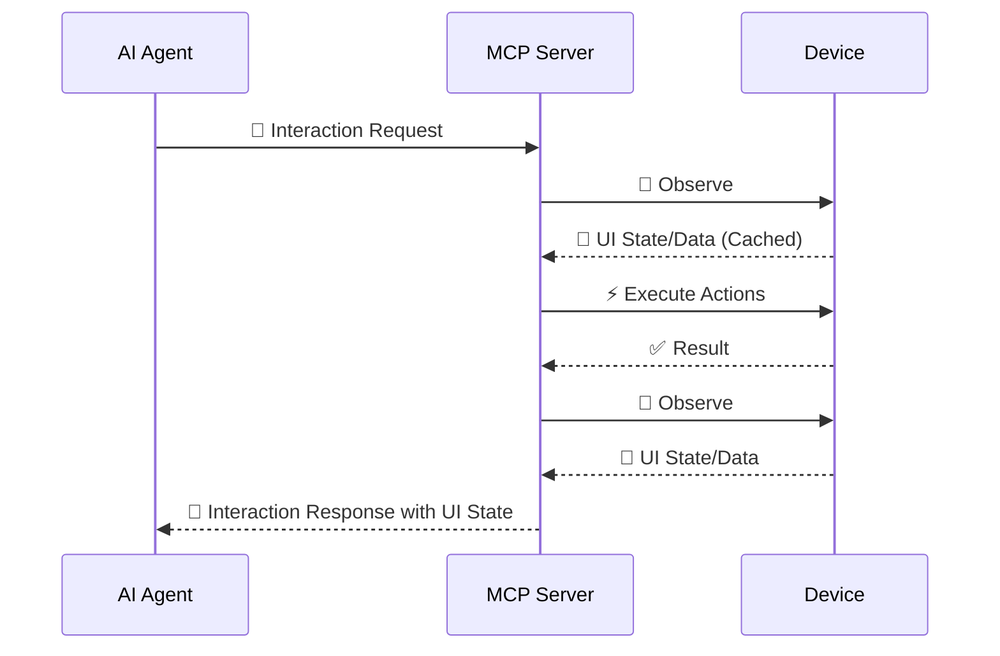

# Interaction Loop

AutoMobile runs an observe → execute → observe loop with UI-stability checks before and after
the action. Observation captures the current UI state and hierarchy; the client sends an action,
and AutoMobile returns the result with a fresh observation, so the next choice never relies on
stale screen state.

Most action tools return the updated observation. Use
`observe` to inspect the current screen without changing it. When a screen is
loading, wait for the target state before acting and prefer stable text,
resource IDs, content descriptions, or app-defined test tags over coordinates.

The default observe skeleton marks a disabled Android or iOS control with
`enabled: false`. Enabled rows omit the field. Toggle rows also carry their
`checked` boolean. Adjustable range widgets carry `adjust`: an Android SeekBar,
AbsSeekBar, RatingBar or Material Slider class, or a finite `range-info` with a
`scroll_forward`, `scroll_backward` or `set_progress` action. A read-only
ProgressBar does not. Every row with valid numeric state shows it as
`range: {current, min, max}`. Unlabelled range controls share the toggle's
container and preceding-sibling label rules in both skeleton and searchable
projections. Selected and focused state remain in full/raw output.

The `swipeOn` tool compares the resolved target's range with the post-action
hierarchy by resource ID (falling back to element ID), using bounds to
distinguish duplicate IDs. Agreeing merged and window copies produce one
`effect.value: {before, after}` only when numeric state changes. Missing, invalid
or ambiguous state omits that field. Full/raw hierarchy and element output
preserve the explicit disabled `enabled` value. The marker describes state and
does not change `tapOn` selection or execution. An enabled-state transition
appears in hierarchy diffs and prevents the settle comparator from treating the
two captures as equal.

The skeleton stays actionable-only; non-actionable rows such as static status
text go to `context`. A positive `waitFor` whose only element predicate is
`text` or `textAny` first searches the hierarchy, then the rows of both arrays
(their `label` and `sublabel`). Any text an agent can read in the default
output is therefore awaitable. Compound, `container`- and `layer`-scoped
waits, `selectionStrategy` and `absent` stay on the hierarchy search, which
describes one source node. A text that any hierarchy node carries also stays
there, so a row label hoisted from an off-screen child cannot override that
search's visibility verdict.

The row search skips a row whose label comes from several sources when any
hierarchy text source inside its bounds that the label or sublabel contains has
no visible part on screen. Rows do not record their sources, so the search infers
contribution from bounds and text. The condition form follows the same rules for
`for: "appear"` and `for: "textEquals"` with only `text` (`textEquals` keeps its
exact, case-sensitive comparison against the row). A `clickable` wait needs a
tappable source node, `disappear` must not pass on a hierarchy miss, and
`countStable` counts hierarchy nodes, so those stay hierarchy-only.

The hierarchy `appear` and `disappear` predicates ignore a match on a tappable
row with hoisted descendant text when the selector matches none of the row's
text that only visible sources back. That text is the row's own text, its
composed label when a visible descendant supplies the folded part, and each
visible descendant's label. The comparison follows the resolver's exact, contains
and regex rules, and an unscoped wait then takes any other match.

Selector resolution for `tapOn` and other actions skips this check: a row stays
tappable while part of it is on screen and uncovered, whichever sources
built its label. The tap point lies in that part, away from the keyboard,
application windows above the row's window and AutoMobile's prototype windows.
For a row inside a scroll container, it also avoids controls drawn over the row
in its own window. iOS counts a control outside that container, or after the row
inside it. Android counts a control outside the container that comes after it in
capture order, and only in captures with per-window trees. When covers leave no
exposed point, the tap fails with a `no-visible-tap-area` error that names the
cover; the same check makes observe report that row `occluded`, with no
affordances. A row with no on-screen part fails with an error that says to
scroll it into view.

iOS simulator lock readings are shared per device. Unlocked known readings use
`knownTtlMs` (30 seconds), locked ones `lockedTtlMs` (2 seconds), and unknown
ones `failureTtlMs` (5 seconds). The first known reading after
invalidation is capped by `settleTtlMs` (2 seconds); subsequent readings use the
normal TTL. Stale in-flight reads cannot consume this settling period. Button
presses, wake-and-unlock (before and after), and device release invalidate the
cache. Observe waits at most 750 ms for a reading. The
`deviceLockUnknown.reason` field is `pending` while the shared 4-second probe
continues, or `timeout`, `error`, or `unparseable` after a failed read. Unknown
readings omit `deviceLock`; they never imply an unlocked device. Probe reads
never reject.

The cache serves an expired known reading stale while one background refresh runs
(120 seconds past expiry for unlocked, 10 seconds for locked; `staleUnlockedMs` /
`staleLockedMs`). A burst of observes on a loaded host therefore does not report
`deviceLockUnknown` because the TTL lapsed (#15311). Invalidation drops the
stale reading; only a device with no recent reading can still report `pending`.

A successful power press always leaves the device locked, but it acknowledges
before SpringBoard publishes the new lockstate, so it invalidates with
`expectLocked`. For `lockTransitionMs` (5 seconds) the cache re-polls an unlocked
reading every `lockTransitionPollMs` (250 ms) instead of caching or serving it.
Observe then reports `pending` rather than a pre-transition `locked: false`
(#17770). The first locked reading ends the window; past it the host reading is
trusted. Any other invalidation cancels a pending transition. Caller abort
detaches cache/budget waits with an unknown `pending` reading and message
`caller aborted`; the shared read continues and can populate the cache. A
notifyutil executor abort becomes an unknown `error` reading.

## Settled embedded observations

A navigation-class action (`tapOn`, `tapAny`, `openLink`, `homeScreen`,
`recentApps`, a navigation `pressButton`, and a submitting `sendKeys`) replaces
the screen. Android can return the destination's hierarchy before it finishes
inflating, missing a child that has not attached yet. For Settings rows that is
the `switchWidget` node that alone carries `toggle` / `checked`, so the parent
row's content-derived `s2-…` elementId would change on the next `observe`.

For those actions AutoMobile gates the embedded capture on hierarchy
stability, using the settle primitive of standalone
`observe(waitFor: {for: "stable"})`. It re-observes until two consecutive
hierarchies are structurally equal, bounded at 1000 ms and cancelled with the
request. In-place and scroll actions keep their single capture.

The settle treats a node as volatile for its remaining comparisons when only the
node's text or visibility changes in a comparison and in either of the two
before it. Examples: a running clock or stopwatch, a paused stopwatch
blinking its time text, a typing indicator and a live counter. Looking back two
comparisons catches a blink whose polls land on the same phase twice in a row.
The settle ignores the node's changes in later comparisons, so such a screen
settles once everything else holds still. The two comparisons that mark the node
still count, so a real transition that rewrites one node's text twice and then
stops does not pass for a ticking node.

The first comparison may be the action's own capture against the first poll
when both show the same screen. It feeds only volatile-node detection, never the
stable pair. The settle identifies the node by resource id, bounds and sibling
position. Structural changes still count: a node added or removed without a
counterpart, a volatile node changing anything else, and any change to another
node. The settle forgets volatile nodes when consecutive reads are not the same
screen.

The budget is a hard cap. Each poll read, the terminal back-stack read and the
attribution reconciliation capture race the remaining budget. The loop aborts
the read the budget cuts off at once and returns the newest trustworthy capture
it already has. A stable pair whose back-stack read or reconciliation capture the
budget cut off is unconfirmed and reports `settled: false`. No poll starts with
less than 100 ms left, since such a read can only return a stale cache.

While the only changes since the last tick are volatile nodes ticking or
blinking, the loop extends the budget by the smaller of 500 ms and half the
budget. A running stopwatch then has room for the three reads and the back-stack
read that prove it: at about 300 ms per read on an emulator, roughly 1.4 s. Any
other change withdraws the extension, so a still-moving screen stops at the plain
budget. A wall-clock fence at the budget plus a margin (the smaller of
1000 ms and the budget) still aborts the loop's signal. It races the whole gate,
for terminal work outside those races and a read that never yields. The `tapOn`
tool takes a per-call `settleTimeoutMs` (0–3000 ms) that replaces the 1000 ms
budget; `0` skips the gate and returns the action capture with `settled: false`.

Every action observation carries a `settled` boolean saying whether that
capture passed the gate:

- `settled: true` — two consecutive stable hierarchies: the settled
  post-action screen. Android synthetic `s2-…` element ids are valid
  only for the observation that returned them. A sibling leaving the screen
  can change an id's suffix; re-observe for the new id if an old id is stale.
- `settled: false` — the capture was not stability-checked. Either the action
  was not navigation-class, or the bound expired on a screen that never
  reaches structural stability (an animation that moves or adds nodes, a
  list still loading). Re-observe if screen completeness matters.

When the gate ran, the observation carries `settleMs` (milliseconds the gate
spent re-observing) and `settlePolls` (how many re-observations it took). A
`settled: false` result with `settleMs` near the budget means the screen
kept changing or device reads were slow; `settlePolls` tells the two apart. A
settle read that fails or is cancelled returns the action's own capture with
`settled: false` and `settleMs` but no `settlePolls`. Both fields are absent when
the action was never gated.

In diff mode (`--actions-diff-observe`) `settled`, `settleMs` and `settlePolls`
ride on the diff alongside `activeWindow` and `freshness`, so one accessor works
in both modes. A diff with no node, display or field change, projected or not,
whose `skeleton`, `context` and `keyboard` equal the ones the baseline's response
delivered, carries `unchanged: true` and leaves those three out; every other diff
carries them. A baseline whose response carried no skeleton never yields
`unchanged: true`. The advertised diff arm
requires `skeleton` or `unchanged`.

A skeleton-projected diff leaves bounds-only changes (moves, resizes or both) out of
`changed`, because the `skeleton` already has the new bounds. The diff drops them for
nodes with no affordance and counts them for actionable nodes in
`relayout: {count, dx?, dy?}`. `dx` and `dy` appear only when every counted change
shares the same non-zero left or top offset, so a resize in place adds neither.

A requested post-action screenshot is published under the same `observationId`
as the hierarchy it should match. Only a settle-gated action can replace its
hierarchy with a later capture, so only it defers the screenshot to the
response boundary and captures the adopted frame. Every other action captures
the screenshot right after its final hierarchy read. The published
observation carries `screenshotHierarchyLagMs`: `screenshotCapturedAt` (host
file time) minus the hierarchy's host receipt time (`viewHierarchy.receivedAt`).
Both operands are on the host clock, so device clock skew cannot shift it.
Apple platforms share the host clock and fall back to the device `updatedAt`
when no receipt time exists; an Android tree without one gets no lag. Above
500 ms (`SCREENSHOT_HIERARCHY_LAG_THRESHOLD_MS`, injectable through the settle
context) it also carries `screenshotHierarchyMismatch: true` and a
`freshness.warning`. A negative lag (screenshot captured before the tree
arrived) is never marked.

Android one-shot native captures without prototype hiding bound the CtrlProxy
request at `ANDROID_CTRLPROXY_CAPTURE_TIMEOUT_MS` (3000 ms) before ADB fallback.
The `CtrlProxyCaptureCooldown` shares per-device failures across
`TakeScreenshot` instances for 60,000 ms, matching the observation-stream reprobe
interval. Timeouts and capture failures arm it; caller cancellation and the
rate-limit result do not. Captures during the cooldown skip CtrlProxy and report
`ctrlproxy_recent_failure`. The first capture at expiry probes again, a failed
probe re-arms the cooldown, and success clears it. Explicit display captures
keep their CtrlProxy error instead of falling back, including during cooldown.
Prototype-hidden captures bypass this cooldown, keep the 10,000 ms timeout,
and never fall back to ADB.

Successful one-shot Android results carry `screenshotCaptureSource`,
`screenshotFallback`, optional `screenshotFallbackReason` and
`screenshotStageDurationsMs` (`ctrlProxyMs?`, `adbMs?`, `totalMs`). The injected
host timer measures them through encoding and persistence; an omitted stage was
not attempted. Observation-scoped state keeps those diagnostics only for the
matching screenshot path; observe keeps its existing freshness meaning of
`screenshotCaptureSource`. Stream screenshot updates forward the same optional
stage timings alongside their backend source and fallback fields. Each one-shot
capture logs its source, fallback reason and stage durations.

After an Android hierarchy sync exhausts its budget with at least 3000 ms of
waiting and no reply, later reads on that client probe for at most 2000 ms. That
lasts until a read succeeds or the 60,000 ms cooldown expires; shorter caller
budgets stay (#18151).

The default compact action metadata section is on its own page:

- [Default compact action metadata](interaction-loop-compaction.md)

## Background

- [Post-action screenshot timing](../../devlog/2026-11-10-interaction-loop-screenshot-timing.md)
- [Stateless success reductions in the response envelope](../../devlog/2026-11-15-stateless-envelope-reductions.md)
