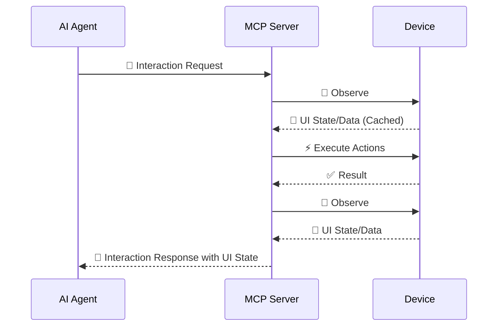

# Interaction Loop

AutoMobile runs an observe → execute → observe loop with UI-stability checks before and after
the action. Observation captures the current UI state and hierarchy; the client sends an action,
and AutoMobile returns the result with a fresh observation, so the next choice never relies on
stale screen state.

Most action tools include the updated observation automatically. Use standalone
`observe` to inspect the current screen without changing it. When a screen is
loading, wait for the target state before acting and prefer stable text,
resource IDs, content descriptions, or app-defined test tags over coordinates.

The default observe skeleton marks a disabled Android or iOS control with
`enabled: false`. Enabled rows omit the field. Toggle rows also carry their
`checked` boolean. Range widgets (a finite `range-info` or the Android SeekBar
class) carry `adjust`; valid numeric state is projected as `range: {current, min,
max}`. Unlabelled range controls share the toggle's container and preceding-sibling
label rules in both skeleton and searchable projections. `swipeOn` compares the
resolved target's range with the post-action hierarchy by resource ID (falling
back to element ID), using bounds to distinguish duplicate IDs; agreeing merged
and window copies produce one `effect.value: {before, after}` only when numeric
state changes. Missing, invalid or ambiguous state omits that field. Selected and
focused state remain in full/raw output.
Full/raw hierarchy and element output preserve the explicit disabled `enabled`
value. The marker describes state and does not change `tapOn` selection or
execution. An enabled-state transition appears in hierarchy diffs and prevents
the settle comparator from treating the two captures as equal.

The skeleton stays actionable-only; non-actionable rows such as static status
text go to `context`. A positive `waitFor` whose only element predicate is
`text` or `textAny` first searches the hierarchy, then the rows of both arrays
(their `label` and `sublabel`), so any text an agent can read in the default
output can also be awaited. Compound, `container`- and `layer`-scoped waits,
`selectionStrategy` and `absent` stay on the hierarchy search, which describes
one source node. A text that any hierarchy node carries also stays there, so a
row label hoisted from an off-screen child cannot override that search's
visibility verdict. A row whose label is composed from several sources is
skipped when any hierarchy text source inside its bounds that the label or
sublabel contains has no visible part on screen; rows do not record their
sources, so contribution is inferred from bounds and text. The condition form
follows the same rules for
`for: "appear"` and `for: "textEquals"` with only `text` (`textEquals` keeps its
exact, case-sensitive comparison against the row). `clickable` needs a tappable
source node, `disappear` must not pass on a hierarchy miss, and `countStable`
counts hierarchy nodes, so those stay hierarchy-only.

The hierarchy `appear` and `disappear` predicates ignore a match on a tappable
row with hoisted descendant text when the selector matches none of the row's text
that only visible sources back: its own text, its composed label when a visible
descendant supplies the folded part, and each visible descendant's label. The
comparison follows the resolver's exact, contains and regex rules, and an unscoped
wait then takes any other match. Selector resolution for `tapOn` and other actions
does not apply this check: a row stays tappable while some part of it is on screen
and not covered, whichever sources built its label. The tap point is picked inside
that part, away from the keyboard, application windows above the row's window and
AutoMobile's prototype windows. Controls drawn over the row in its own window are
avoided as well, for a row inside a scroll container. iOS counts a control outside
that container, or after the row inside it. Android counts a control outside the
container that comes after it in capture order, and only in captures with
per-window trees. When covers leave no exposed point,
the tap is refused with a `no-visible-tap-area` error that names the cover, and
observe reports that row `occluded`, with no affordances, from the same check. A row
with no on-screen part is refused and the error says to scroll it into view.

iOS simulator lock readings are shared per device: unlocked known readings use
`knownTtlMs` (30 seconds), locked readings use `lockedTtlMs` (2 seconds), and
unknown readings use `failureTtlMs` (5 seconds). The first known reading after
invalidation is capped by `settleTtlMs` (2 seconds); subsequent readings use the
normal TTL. Stale in-flight reads cannot consume this settling period. Button presses, wake-and-unlock (before and after),
and device release invalidate the cache. Observe waits at most 750 ms for a reading;
`deviceLockUnknown.reason` is `pending` while the shared 4-second probe continues,
or `timeout`, `error`, or `unparseable` after a failed read. Unknown readings omit
`deviceLock`; they never imply an unlocked device. Probe reads never reject.
An expired known reading is served stale while one background refresh runs
(120 seconds past expiry for unlocked, 10 seconds for locked; `staleUnlockedMs` /
`staleLockedMs`), so a burst of observes on a loaded host does not report
`deviceLockUnknown` just because the TTL lapsed (#15311). Invalidation drops the
stale reading; only a device with no recent reading can still report `pending`.
A successful power press always leaves the device locked, but it acknowledges before
SpringBoard publishes the new lockstate, so it invalidates with `expectLocked`: for
`lockTransitionMs` (5 seconds) an unlocked reading is re-polled every
`lockTransitionPollMs` (250 ms) instead of cached or served, so observe reports
`pending` rather than a pre-transition `locked: false` (#17770). The first locked
reading ends the window; past it the host reading is trusted. Any other invalidation
cancels a pending transition.
Caller abort detaches cache/budget waits with an unknown `pending` reading and
message `caller aborted`; the shared read continues and can populate the cache.
A notifyutil executor abort becomes an unknown `error` reading.

## Settled embedded observations

A navigation-class action (`tapOn`, `tapAny`, `openLink`, `homeScreen`,
`recentApps`, a navigation `pressButton`, and a submitting `sendKeys`) replaces
the screen. Android can return the destination's hierarchy before it finishes inflating, missing a
child that has not attached yet (for Settings rows, the `switchWidget` node that alone carries
`toggle` / `checked`), so the parent row's content-derived `s2-…` elementId would change on the
next `observe`.

For those actions AutoMobile gates the embedded capture on hierarchy
stability before returning it, using the same settle primitive standalone
`observe(waitFor: {for: "stable"})` uses: re-observe until two consecutive
hierarchies are structurally equal, bounded at 1000 ms and cancelled with the
request. In-place and scroll actions are unchanged and keep their single
capture.

A node whose text or visibility alone changes in two consecutive comparisons (a
running clock or stopwatch, a paused stopwatch blinking its time text, a typing
indicator, a live counter) is treated as volatile for the rest of that settle:
those changes in later comparisons are left out, so such a screen settles once
everything else holds still. The two comparisons that mark the node still count,
so a real transition that rewrites one node's text twice and then stops is not
mistaken for a ticking node. The first comparison may be the action's own
capture against the first poll when both show the same screen; it feeds only
volatile-node detection, never the stable pair. The node is identified by
resource id, bounds and sibling position. Structural changes still count: a node
added or removed without a counterpart, a volatile node changing anything else,
and any change to another node. Volatile nodes are forgotten when consecutive
reads are not the same screen.

The budget is a hard cap. Each poll read, the terminal back-stack read and the
attribution reconciliation capture race the remaining budget; the read the
budget cuts off is aborted at once, and the loop returns the newest trustworthy
capture it already has. A stable pair whose back-stack read or reconciliation
capture the budget cut off is unconfirmed and reports `settled: false`. No poll starts with less than 100 ms left, since such
a read can only return a stale cache. While the only changes since the last tick
are volatile nodes ticking or blinking, the budget is extended by the smaller of
500 ms and half the budget, so a running stopwatch has room for the three reads
and the back-stack read that prove it; at about 300 ms per read on an emulator
that is roughly 1.4 s. Any other change withdraws the extension, so a screen
that is still moving stops at the plain budget. A wall-clock fence at the budget plus a
margin (the smaller of 1000 ms and the budget) still aborts the loop's signal
and is raced against the whole gate, for terminal work outside those races and
a read that never yields. `tapOn` takes a
per-call `settleTimeoutMs` (0–3000 ms) that replaces the 1000 ms budget; `0`
skips the gate and returns the action capture with `settled: false`.

Every action observation carries a `settled` boolean saying whether that
capture passed the gate:

- `settled: true` — two consecutive stable hierarchies; the screen is the
  settled post-action screen. Android synthetic `s2-…` element ids are valid
  only for the observation that returned them. A sibling leaving the screen
  can change an id's suffix; re-observe and use the new id if an old id is stale.
- `settled: false` — the capture was not stability-checked. Either the action
  was not navigation-class, or the bound expired on a screen that never
  reaches structural stability (an animation that moves or adds nodes, a
  list still loading). Re-observe if the completeness of the screen matters.

When the gate ran, the observation also carries `settleMs` (milliseconds the gate
spent re-observing) and `settlePolls` (how many re-observations it took). A
`settled: false` result with `settleMs` near the budget means the screen
kept changing or device reads were slow; `settlePolls` tells the two apart. A
settle read that fails or is cancelled returns the action's own capture with
`settled: false` and `settleMs` but no `settlePolls`. Both fields are absent when
the action was never gated.

In diff mode (`--actions-diff-observe`) `settled`, `settleMs` and `settlePolls`
ride on the diff alongside `activeWindow` and `freshness`, so one accessor works
in both modes.

A requested post-action screenshot is published under the same `observationId`
as the hierarchy it should match. Only a settle-gated action can replace its
hierarchy with a later capture, so only it defers the screenshot to the
response boundary and captures the adopted frame. Every other action captures
the screenshot right after its final hierarchy read. The published
observation carries `screenshotHierarchyLagMs`: `screenshotCapturedAt` (host
file time) minus the hierarchy's host receipt time (`viewHierarchy.receivedAt`),
so both operands are on the host clock and device clock skew cannot shift it.
Apple platforms share the host clock and fall back to the device `updatedAt`
when no receipt time exists; an Android tree without one gets no lag. Above
500 ms (`SCREENSHOT_HIERARCHY_LAG_THRESHOLD_MS`, injectable through the settle
context) it also carries `screenshotHierarchyMismatch: true` and a
`freshness.warning`. A negative lag (screenshot captured before the tree
arrived) is never marked. Android one-shot native captures without prototype hiding
bound the CtrlProxy request at `ANDROID_CTRLPROXY_CAPTURE_TIMEOUT_MS` (3000 ms)
before ADB fallback. `CtrlProxyCaptureCooldown` shares per-device failures across
`TakeScreenshot` instances for 60,000 ms, matching the observation-stream reprobe
interval. Timeouts and capture failures arm it; caller cancellation and the
rate-limit result do not. Captures during the cooldown skip CtrlProxy and report
`ctrlproxy_recent_failure`; the first capture at expiry probes again, a failed
probe re-arms the cooldown, and success clears it. Explicit display captures
retain their CtrlProxy error instead of falling back, including during cooldown.
Prototype-hidden captures bypass this cooldown, retain the 10,000 ms timeout,
and never fall back to ADB. Successful one-shot Android results carry
`screenshotCaptureSource`, `screenshotFallback`, optional `screenshotFallbackReason`
and `screenshotStageDurationsMs` (`ctrlProxyMs?`, `adbMs?`, `totalMs`), measured
with the injected host timer through encoding and persistence. Omitted stages
were not attempted. Observation-scoped state retains those diagnostics only for
the matching screenshot path; observe preserves its existing freshness meaning
of `screenshotCaptureSource`. Stream screenshot updates forward the same optional
stage timings alongside their backend source and fallback fields. Each one-shot
capture logs its source, fallback reason and stage durations.
After an Android hierarchy sync exhausts its budget with at least 3000 ms of
waiting and no reply, later reads on that client probe for at most 2000 ms until
a read succeeds or the 60,000 ms cooldown expires; shorter caller budgets are
preserved (#18151).

## Default compact action metadata

Compact action metadata defaults on. Opt out with
`AUTOMOBILE_ACTIONS_COMPACT_METADATA=0`, `--no-actions-compact-metadata`, or
feature-flag key `actions-compact-metadata` set to false. The existing
`--actions-compact-metadata` or exact env `1` explicitly enables it. Negative CLI
wins over positive CLI, then exact env `0`/`1`, then persisted state, then on.
An explicit CLI/env choice is connection-scoped: the proxy relays it on its
connection profile, never restarts the shared daemon for it, and never persists it.
Without an explicit choice (unset or other env values), proxies relay no preference
and use the shared daemon's effective setting.
With an external action call's `sessionUuid` and session store,
this omits each unchanged `observation` block independently: `insets`,
`systemInsets`, `backStack`, `gfxMetrics`, `displayedTimeMetrics`, `deviceLock`, `deviceLockUnknown`,
`accessibilityState`, and `freshness`. Raw observations' `viewHierarchy.insets`
and `viewHierarchy.systemInsets` copies follow the same rule independently.
`deviceLock` and `deviceLockUnknown` form one mutually exclusive block: a delivered
variant replaces the sibling in both the server snapshot and the client's state.
A variant transition always sends the new field in full; omission of both means
unchanged. Values must be deeply equal except `backStack.capturedAt`. Stale freshness,
unstable gfx metrics, and partial back stacks remain inline even if unchanged.
The first action response sends available blocks in full, changes resend the
changed block, and a new session or any device switch sends available blocks
in full again. `screenSize`, `display`, and observation/device join keys remain
present. A top-level `element` is omitted only when deeply equal to
`selectedElement.matchedElement` and its output schema allows omission.

Compaction follows projection and diff emission. With `--actions-diff-observe`,
only metadata actually emitted by the diff can be compacted (including its
`freshness` passthrough); the hierarchy diff baseline is unchanged. With
`--actions-no-observe`, there are no observation blocks to compact or remember,
but duplicate element removal still applies. An empty snapshot on a device
switch invalidates the previous device's metadata without claiming delivery.

Only blocks that survive artifact and oversized-residue spills **inline** are
remembered as sent, and artifacts are always written from the uncompacted payload;
an artifact pointer does not count as delivery. Any non-internal session-scoped
response that carries a block inline (including `observe` and error responses,
which never omit blocks themselves) updates the record for exactly those blocks.
`freshness` with `isFresh !== true` and `gfxMetrics` with `isStable === false`
are always sent. Internal tool-to-tool calls neither omit nor record, and calls
without a session/store emit the existing full response. The record lives in the
session cache and is cleared on session release/rebind. It is written while the
response is finalized, before the transport sends it, so a response dropped
after that point leaves the client without the omitted block until it changes.

## Background

- [Post-action screenshot timing](../../devlog/2026-11-10-interaction-loop-screenshot-timing.md)
