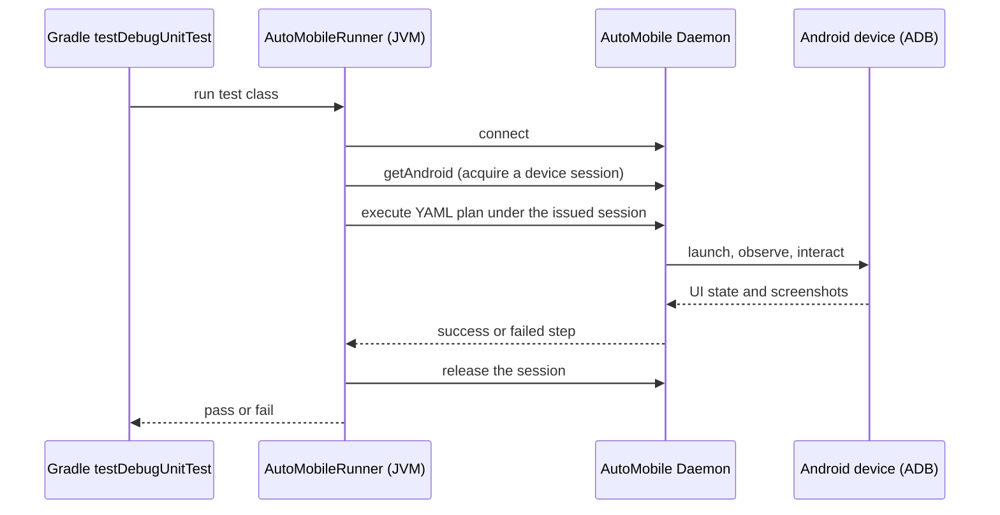
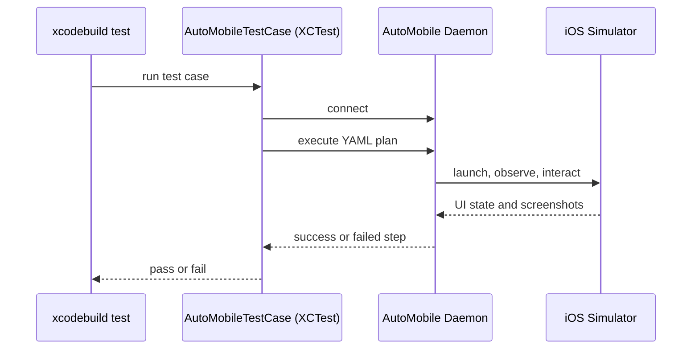

# Test runners

AutoMobile plans run from a normal platform test: the test owns pass/fail
assertions while the YAML plan keeps device actions easy to review. See
[UI tests](../../../../using/ui-tests.md) for setup and copy-paste code.

## Android

The JUnit runner lets a normal JVM test execute a plan against a connected
Android device.

Each attempt runs under a session the daemon issued: the daemon refuses a
`sessionUuid` it never issued, so the runner acquires one with `getAndroid`
(on the configured device or `ANDROID_SERIAL`, otherwise the first booted
device `automobile:devices/booted/android` lists as free) and releases it when
the attempt ends. A failed attempt held for AI recovery is released by the
recovery flow instead, unless the daemon reports it as not held.

## iOS

The XCTestRunner lets an `AutoMobileTestCase` execute a plan against a booted
iOS Simulator.

